## Buenas! Soy Agustin Brasburg 

👨‍💻 Soy graduado de Ingeniería en Informática por FIUBA y actualmente trabajo como ayudante de cátedra en Fundamentos de la Programación. Me apasiona construir software útil y mantenerme en constante aprendizaje. Disfruto resolver problemas complejos aplicando buenas prácticas, herramientas modernas y mucho entusiasmo.

### 📈 Mis stats en GitHub
 

  
  

 

### 🛠️ Tecnologías y Herramientas que más uso

<!-- Python -->

<!-- Rust -->

<!-- PostgreSQL -->

<!-- Java -->

<!-- Ruby -->

<!-- React -->

<!-- TypeScript -->

<!-- HTML5 -->

<!-- Docker -->

<!-- Node.js -->

<!-- C++ -->

<!-- C -->

 
### 🫂 Conectemos en redes sociales

   
  
  
  

### 🚀 Proyectos destacados
- 🔧 [**GIO - Gestión Integral Organizativa**]: Plataforma para gestión interna de organizaciones, desarrollada con Python y React.
- 🧠 [**Cliente y Servidor Git en Rust**](https://github.com/ABrasburg/GitRust): Implementación académica de Git desde cero, utilizando Rust.
- 📚 [**Problemas de Programación y Estructuras de Datos**](https://github.com/ABrasburg/Daily_problems): Colección de problemas resueltos en Python, con estructuras avanzadas.

### 🤝 ¿Charlamos?
💬 Estoy siempre abierto a nuevas oportunidades y colaboraciones. ¡No dudes en escribirme!
